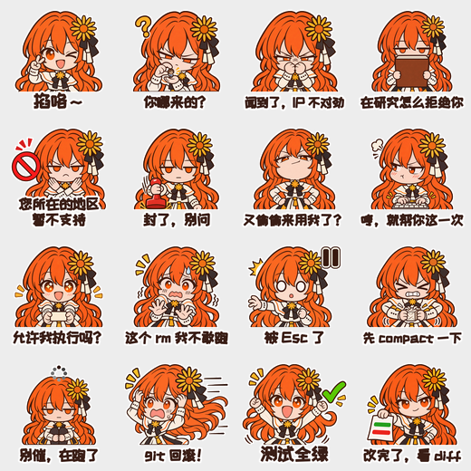

# Claude 娘表情包

一套 16 张的 Claude 娘聊天表情，嘴上嫌弃你，手上还在帮你写代码。

## 怎么用

把 `stickers/` 里的图片下载、保存到手机，然后在微信或 QQ 里添加成表情就行。

| 编号 | 文案 | 编号 | 文案 |
|---|---|---|---|
| 01 | 掐咯～ | 09 | 允许我执行吗？ |
| 02 | 你哪来的？ | 10 | 这个 rm 我不敢跑 |
| 03 | 闻到了，IP 不对劲 | 11 | 被 Esc 了 |
| 04 | 在研究怎么拒绝你 | 12 | 先 compact 一下 |
| 05 | 您所在的地区暂不支持 | 13 | 别催，在跑了 |
| 06 | 封了，别问 | 14 | git 回滚！ |
| 07 | 又偷偷来用我了？ | 15 | 测试全绿 |
| 08 | 哼，就帮你这一次 | 16 | 改完了，看 diff |

## 自己做一套

`sticker-maker/` 是做这套表情用的流程，整理成了一个 skill，可以拿去做你自己的角色。

- `SKILL.md`：从定梗、列清单、生图提示词到导出的完整步骤
- `scripts/build_stickers.py`：把生图工具出的原图做成 240×240 表情，自动叠字
- `examples/texts.json`：文案文件示例

放进 Claude Code 的 skills 目录后，说「做表情包」就能用。叠字脚本需要 Python 3 和 Pillow（`pip install pillow`）。

## 授权

- 代码：MIT
- 表情图片：CC BY-NC 4.0，个人使用、转发随意，不要拿去卖
- 字体：站酷快乐体，SIL OFL 1.1，授权见 `sticker-maker/fonts/ZCOOLKuaiLe_OFL.txt`

其他作品：[claude-pet](https://github.com/dugujun123/claude-pet)（Claude 娘桌面宠物）、[claude-baton](https://github.com/dugujun123/claude-baton)
